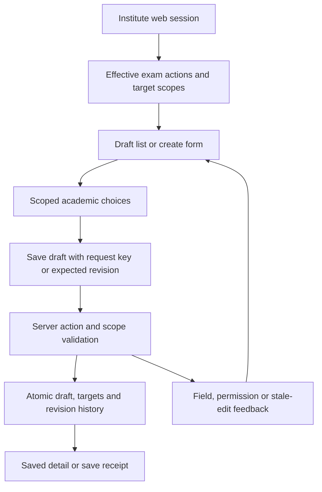

# Exam creation and scheduling

Author: CampusOne product and engineering collaboration
Date: 2026-10-23
Status: Finalized design. Implementation has not started; generic development EXAM data reset is authorized during implementation.
Inputs: [Approved concepts brief](concepts_brief.md), [Goldfish findings](exam_scheduling_goldfish_review.md).

## Overview

Build an exam workflow that starts with a saved draft and grows into subject setup, scheduling, validation, and publication. One exam event can cover several classes, each with its own subjects and schedule. A class test uses the same procedure with a single class.

The first implementation slice is exam draft management: create, save, list, reopen, and edit with the applicable permissions. Subject setup, timed papers, publication, rooms, seating, and confidential question papers follow in the approved delivery order. This boundary preserves the later scheduling features.

Actions and class access use CampusOne's RBAC. An authorized teacher may create a test for a class outside their teaching assignments. An exam controller or any other role may receive equivalent authority through permissions. Teachers with the relevant publishing permission can publish their own class tests without a separate approval step once publication is delivered.

## The Problem

Staff need to prepare common exams without recreating the event independently for each class, while keeping each class's subject schedule independent. Teachers also need a short procedure for individual class tests.

The current checkout contains generic academic operation records and academic master data. It does not establish the structured exam, publication, and candidate guarantees needed by this proposal. Extending it must avoid two competing exam records, accidental widening of existing permissions, and lost edits. Later hall tickets and marks entry must be able to identify the exam and subject they belong to.

## Goals

### First slice: exam draft management

1. An authorized user can save one exam draft for one or several classes, reopen it after a page reload, and edit its details.
2. A class test can be created through a short single-class path. Advanced options appear only when needed.
3. Class choices come from current academic records, constrained by the selected academic year, institute, campus and effective permission scope. Duplicate or incompatible targets are rejected with field-level feedback.
4. Proposed minimum save fields are name, academic year, exam category and at least one permitted class/section target with an explicit campus context. Term, date range, coordinator and instructions may remain incomplete in a draft. Exact class/section representation is settled in the technical section.
5. Creation, viewing and editing each require the applicable action and scope. Being the creator, having a teacher title, or receiving create permission does not automatically grant other actions.
6. Broader scope can explicitly cover selected classes or authorized branch/institute classes. An exam controller is configured through grants rather than a special role-name check.
7. Invalid, denied, expired-access and stale-edit outcomes are distinguishable. Failed saves preserve recoverable form values; successful saves produce a stable identifier and clear saved state.
8. Start the new exam workflow with empty exam data. The user authorized deleting existing exam records during implementation. Replace the old exam writer; no legacy exam conversion or compatibility list is required. Keep unrelated academic records outside the reset.
9. Record attributable create/edit outcomes using the existing audit/error mechanisms where suitable. Define scope rules for legacy permission grants before enabling new endpoints.
10. If duplication is included in this slice, it creates an independent draft and checks current target permissions; it never copies marks, candidate assignments or publication state. Its exact boundary is settled in the technical section.

### Later scheduling outcome

Staff can configure each class's subject/component assessments, enter paper times in a bulk grid, resolve conflicts and publish an identifiable timetable revision. The system must distinguish unperformed checks from successful checks, preserve the meaning of published inputs, and prevent concurrent publications from accepting conflicting candidate or resource intervals.

Room assignments, invigilators, seating and the question paper vault retain their separate delivery stages. Their guarantees apply only after the corresponding stage is implemented and verified.

## Non-Goals for the first slice

- Published timetable output, automatic scheduling and candidate conflict guarantees.
- Marks entry, grade calculations, result publication, promotion and cumulative results.
- Hall ticket and marksheet design or issuance.
- Room and invigilator allocation, seating, attendance sheets and question paper security.
- Parent notifications, dispatch and automatic student portal exposure.
- Replacing CampusOne's access-control system or granting permissions solely from a role's name.

These remain later work where covered by the approved roadmap; the first slice must not expose controls that claim those functions are available.

## Critical User Journeys

### 1. Prepare a shared exam draft

- Given an active user with create and view permissions covering several classes in the selected institute/campus context.
- When the user creates an exam, selects those classes, saves and reloads.
- Then one persisted draft appears with the same selected classes and saved details. It is ready for later independent subject schedules; no shared-time assumption is introduced.

### 2. Prepare an individual class test

- Given an authorized user and one permitted class.
- When the user selects the class-test category, supplies minimum details and saves.
- Then the system saves a single-class draft through the same workflow without requiring a multi-class event, rooms or confidential files.

### 3. Use an explicit cross-class grant

- Given a teacher with a grant covering a class they do not teach.
- When the teacher creates a test for that class.
- Then the request succeeds within the granted scope. An equivalent request without scope authority is denied by the server and the UI explains the restriction without exposing inaccessible class data.

### 4. Reopen and edit a draft

- Given an existing draft and a user with view/edit authority over all affected targets.
- When the user changes details or targets and saves.
- Then the server validates the existing and proposed scopes and persists the new revision. A stale edit is rejected with a recovery path that retains the user's entered values; exact mechanics follow in the technical plan.

### 5. Respect permission loss

- Given a user whose relevant grant expires or is revoked after opening the form.
- When the user next reads or saves through the server.
- Then access reflects the current grant. The response does not expose newly inaccessible data or silently persist the edit.

## Open Questions and Design Tasks

Resolve within the technical section before producing a file-by-file implementation plan:

- Map current exam routes, generic record readers/writers, policy resolvers, teacher route access and audit infrastructure; select the single write authority, bounded development reset and recovery behavior for newly created data.
- Specify class, section and campus targets, minimum field validation, exam categories and duplicate-draft behavior.
- Specify action grant configuration, scope combination, legacy/unknown configuration handling, delegation and deliberate initial grants. Do not silently broaden existing access.
- Define the saved draft's revision and stale-edit recovery contract.

Resolve before later stages that depend on them:

- Assessment/component/pass-rule families, elective registrations and practical-batch membership.
- Publication audience, incomplete candidate coverage policy, overridable warnings and roster correction policy.
- Resource capacity, clearance buffers, accommodations, staff availability and confidential-file release rules.

## Technical Plan

### 1. Delivery boundary and entry point

Deliver the first slice in the existing Assessment & Results workspace (`AAR1`) instead of creating a second exam product. Show Draft Exams. Route aliases from the older Exams workspace must lead to the same new writer. Keep question-bank and other unrelated academic operations on their existing routes.

The first slice supports creation, listing, detail, editing and duplication of structured exam drafts. Publication and status changes beyond DRAFT have no callable action yet. The user-confirmed publishing policy is retained for Stage 4.

Each new event belongs to one institute, one campus and one academic year. It can target several grades/sections in that campus. Cross-campus common exams remain a later extension; institute-wide permission means the actor may choose any authorized campus, not that one draft spans campuses.

### 2. Verified implementation constraints

| Source | Observed behavior and design consequence |
| --- | --- |
| `services/api/modules/academics/api/views.py:65–128` | Generic operations use `IsCurrentInstituteAdmin`; creation accepts a general payload, and patching can change status. New scoped endpoints and legacy writer restrictions are necessary. |
| `services/api/modules/access_control/policies.py:5–26` and `selectors.py:27–56` | Shared checks resolve permission keys, not class scope configuration. Institute grants flow into a branch; branch grants do not flow sideways. Extend the policy layer with exam-scoped grant evaluation rather than changing other permission semantics. |
| `services/api/modules/institutes/api/permissions.py:45–73` | Existing guard accepts institute/branch admins and checks onboarding restrictions. It cannot serve as the teacher-access guard. Preserve those tenant eligibility checks in the new guard. |
| `services/api/modules/access_control/api/permissions.py:20–32` | Access-control sessions attach tenant context but require an admin-web token. Reuse the session-context pattern; do not equate it with class authorization. |
| `services/api/modules/identity/services.py:7–16` | `admin-web` sessions currently admit only institute/branch admin membership types; teachers/staff use `staff-mobile`. Teacher web access therefore needs a deliberate identity/UI integration, not only a new exam endpoint guard. |
| `services/api/modules/academics/models.py:243–280,313–338` | ClassSection identifies campus, grade and academic year; SubjectTeacherAssignment identifies a teacher's section/subject. Use these IDs for targets and assignment scope. |

The graft caller graph reports ambiguous AcademicOperation names and no complete incoming-edge inventory. An exhaustive indexed search found model, serializers, routes, generic views and existing API tests. The implementation checklist must also inspect frontend consumers and unindexed files; graph edges alone are not exhaustive evidence.

### 3. Data model

Add four structured records under academics. Exact filenames and migration dependencies will be fixed in the implementation section.

| Record | Fields and invariants |
| --- | --- |
| Exam | UUID; institute; campus; academic year; optional term; name (trimmed, 1–250 characters); category; optional start/end dates; optional coordinator user; instructions; status fixed to DRAFT for this slice; positive integer revision starting at 1; created/updated actor and timestamps; optional source exam reference for duplication |
| ExamTarget | Exam and ClassSection foreign keys, unique together; every target must match the exam's institute, campus and academic year |
| ExamDraftChange | Exam, resulting revision, actor plus immutable actor ID/display snapshot, timestamp, action and reconstructable changed fields/target IDs; one record per committed revision. Used for draft history and support; it is not a published timetable snapshot |
| ExamRequestReceipt | Institute, actor, action, request UUID, canonical fingerprint, nullable exam reference, saved revision and timestamp; unique on request identity. If the exam is explicitly deleted, retain the minimal receipt so replay cannot recreate it. |

Categories: CLASS_TEST, UNIT_TEST, HALF_YEARLY, PRE_BOARD, ANNUAL, PRACTICAL, OTHER. Store a category code and an optional custom label for OTHER; do not derive final result weighting or pass rules from category. A CLASS_TEST targets one grade but may include selected sections of that grade. Shared exam categories may target several grades.

Selecting a grade in the UI expands into explicit current ClassSection targets. Show the selected section count before save. New sections created afterward do not silently join the exam. A grade without a section offers an actionable setup message; it cannot become an ambiguous target. Subject schedules later reference the exam and explicit class targets.

Require name, campus, academic year, category and a nonempty target list to save. Dates are both absent or both present; when present, end is on/after start and both fall within the academic year and selected term where supplied. Term must belong to the selected year. Coordinator is optional and must be an active member of the institute with access to the campus; selecting them grants no permission. Instructions are plain text, maximum 10,000 characters, and names/custom labels are escaped on render.

Protect institute, campus, academic-year and section identities from deletion while referenced by an exam. Term references are also protected to retain historical context. Coordinator deletion sets the coordinator to null; source-exam deletion sets the source reference to null. History actor references and receipt exam references may become null only while retaining immutable actor ID/display snapshots or the receipt's request identity, saved revision and timestamp. Targets and history are removed only by a future explicitly authorized exam deletion; no cascade may silently delete unrelated records. Do not require candidate roster or paper rows at this stage. Do not copy live academic names into unstructured payloads as the authoritative relationship.

While any non-cancelled exam targets a section, block edits to that section's campus, grade or academic year and return the affected exam IDs. Exam target writes and section identity edits must serialize transactionally so a concurrent edit cannot invalidate target scope. Resolve or cancel the listed exams before changing section identity.

### 4. Scoped permissions

Use existing `assessment.create` and introduce `assessment.view` and `assessment.edit` for this slice. Duplicate requires view on the entire source plus create on every destination target. It never implies edit or publish. Introduce later action permissions only when those actions are delivered.

For each action, validate an exam-specific grant configuration with an explicit schema version and one scope mode. Version 1 uses `classSectionIds` for selected section-level access and `classSubjectPairs: [{classSectionId, subjectId}]` for subject-limited access; pairs are tuples, never separate section and subject arrays that could imply a Cartesian product. If both are present, the grant authorizes section-level access to listed `classSectionIds` and subject-level access only to listed pairs. Valid grants for the same action union their coverage at the declared granularity; they never combine across different actions. Stage 1 uses section-level access; subject pairs are validated and consumed when subject scheduling is delivered.

- assigned: current SubjectTeacherAssignment section/subject pairs plus class-teacher sections. Class-teacher scope covers that section; subject-teacher scope carries subject restrictions into Stage 2. A subject assignment may establish a draft's class target, but cannot authorize arbitrary subjects later.
- selected: explicit academic-year-bound section IDs and/or section-subject tuples as described by the versioned grant JSON. Every ID must belong to the grant's institute and allowed campus.
- branch: all sections in the role assignment's authorized campus, intersected with any branch fixed on the role itself.
- institute: all sections in the institute, usable only through an institute-wide role and assignment. It cannot be attached to a branch assignment to widen access.

An action's authorized targets are the union of valid active grants for that same action, intersected with institute/campus and any subject restrictions. Evaluate action and target together; never combine the create scope with edit or publish. Selected/assigned scopes must retain their section-subject pairing rather than taking an unrestricted Cartesian product. Enforce active user/institute/membership, active role/permission, assignment validity and revocation at each request.

Listing/detail require view coverage of every target in an event. An event-wide edit also requires edit coverage of the entire current target set and requested new target set. Staff may later receive paper-specific editing, but partial record access is not implemented implicitly. Out-of-scope detail IDs return 404; valid sessions lacking the action receive 403 with a stable permission error code. Metadata endpoints return only authorized choices.

The institute-admin all-permissions behavior remains as implemented in `actor_is_institute_admin`. Other membership titles do not bypass exam scope evaluation. An exam-controller custom role is an explicit collection of grants, without a special membership enum or role-name branch.

Legacy scope handling: empty or unrecognized configuration on `assessment.create` confers no access to the new structured exam endpoints for non-admin users. It retains its existing meaning for older consumers. Display a needs-configuration state in Role Builder and let an authorized administrator deliberately configure the new scope and view/edit grants before staff activation. Reject new malformed configuration rather than silently interpreting it. Avoid mass-granting publish authority or broadening every existing assessment role.

Scope delegation must be bounded as well as permission-key delegation: grant administrators can issue only an equal or narrower target/subject scope they are authorized to delegate, with institute-admin handling consistent with the existing system. The Role Builder adds scope fields for these assessment actions using existing permissionOptions transport; the server validates every grant. Its permission choices must come from an active full permission catalog, including `assessment.view` and `assessment.edit` even when no current role holds them, filtered by the administrator's delegable keys and scope. Do not infer the catalog solely from current role grants or auto-grant new permissions. Do not rely on arbitrary JSON being safe because the current transport accepts it.

### 5. Teacher web-session access

Extend admin-web eligibility to active TEACHER/STAFF memberships only when an effective, configured exam view or create grant exists at an authorized scope. Existing admins retain current eligibility. Use the normal login/token/session-context flow and onboarding eligibility; never accept a client-supplied institute or user as authority.

Add a shared active institute-web-session guard for the new exam routes and scoped exam-choice routes. Apply action/scope policy after the guard. Preserve `IsCurrentInstituteAdmin` on existing admin-only endpoints. The web shell must fetch effective exam capabilities for the authenticated membership and permit only the exam workspace and required scoped setup data for these users. Do not depend on all-admin dashboard bootstrap requests succeeding for teachers.

Trace session refresh, navigation, route gating and context bootstrap before activation. Login eligibility is not an endpoint permission. Expired/revoked grants must deny subsequent exam operations even if a token is still unexpired. Staff with grants and no eligible membership need normal institute membership provisioning; assigning a custom role alone does not invent a login identity.

### 6. API contract

Paths below are relative to the existing institute API prefix. Use existing JSON envelopes, field errors, pagination and correlation IDs.

| Endpoint | Contract |
| --- | --- |
| GET `academics/exams/options` | `?kind=bootstrap\|sections\|terms\|coordinators&action=&campusId=&academicYearId=&search=&page=&pageSize=`. Return allowed campus/year/section/coordinator choices, categories and effective create/view/edit scope information. Return only data the user may use; no full institute roster or confidential data. |
| GET `academics/exams` | `?campusId=&academicYearId=&category=&search=&page=&pageSize=`. Existing paginated envelope with `results` containing only view-authorized drafts; each row includes id, name, category, status, target summary, dates, revision and actions. |
| POST `academics/exams` | Body: `{requestId, campusId, academicYearId, termId?, category, name, classSectionIds, startsOn?, endsOn?, coordinatorId?, instructions?}`. `requestId` is a UUID; `termId`, dates, coordinator and instructions may be omitted or null. Server sets institute, actor, DRAFT and revision. Return 201 with `data: {id, revision, ...detail}` when view is allowed; otherwise return only `{data: {requestId, examId, savedRevision}}`. |
| GET `academics/exams/{id}` | View-authorized `data: {id, campusId, academicYearId, termId, category, name, classSectionIds, startsOn, endsOn, coordinatorId, instructions, status, revision, actions}`. Nullable values are JSON null. |
| PATCH `academics/exams/{id}` | Body: `{expectedRevision, name?, category?, termId?, classSectionIds?, startsOn?, endsOn?, coordinatorId?, instructions?}`. Omitted fields stay unchanged; null clears nullable term/date/coordinator/instructions values where valid. Targets, if supplied, replace the complete set. Reject status/tenant/actor fields. Require view/edit coverage and compare revision atomically. Return updated detail and incremented revision. |
| POST `academics/exams/{id}/duplicate` | Body: `{requestId, campusId, academicYearId, classSectionIds, name, termId?, startsOn?, endsOn?}`. Source view permission; optional destination term and date range are revalidated. Copy category/instructions only by default. Clear coordinator and dates unless explicitly supplied. Return an independent draft or minimal receipt when view is unavailable. |

No DELETE or publish endpoint in the first slice. Include a small capability endpoint or options response usable before loading the workspace, so create-only grants can open the form even when no list is accessible. After a create-only save, return a save receipt without revealing unauthorized detail and explain that reopening requires view; the Role Builder presents a usable create+view+edit preset without automatically adding those actions.

Error outcomes use stable codes in the existing error envelope: `validation_error` (400, field errors), `authentication_required` (401), `permission_required` (403), `not_found` (404 for missing or scope-hidden detail), `revision_conflict` (409, current revision only when view-authorized), `request_key_conflict` (409 for a reused key with different canonical input), and `request_target_unavailable` (409 when a replay receipt's exam has been explicitly deleted). Database failures return the existing sanitized server-error envelope with correlation ID. Never turn a failed save into an empty-success list.

### 7. Commit behavior and edit recovery

Create/update targets and the matching ExamDraftChange within one database transaction. Lock the exam row for PATCH, compare expectedRevision, validate current and requested scope, write target changes and increment revision once. No-op saves return the existing revision. Failed validation leaves the prior draft intact.

Creation/duplication retries use a compact request receipt keyed by institute, actor, action and request UUID, with a canonical request fingerprint and resulting exam ID/saved revision. Store it atomically with the draft. A replay with the same input rechecks current session, action and scope authority, then returns only the original minimal receipt; it does not return current exam detail or require view permission. A changed payload with the same key returns 409. If the referenced exam no longer exists, return a stable unavailable-receipt error without recreating it. Serialize competing uses of a key through a unique constraint and transaction retry. Retain receipts with the draft in this slice; no queue or scheduled cleanup dependency is needed.

The editor retains entered values until a save succeeds or the user explicitly discards them. On 409, show the current revision only if still view-authorized, preserve local values and offer compare/copy/reload. Do not silently overwrite or auto-merge. On permission loss, stop server access, explain the denial and avoid loading new inaccessible data; recoverable form state is transient memory, not persistent browser storage.

Use existing mutation audit for the successful event and request/error infrastructure for failure correlation. Draft revision history is committed with state; any external audit emission occurs after commit and must not produce a false save-failed response for a committed draft.

### 8. Development reset and single exam writer

The user approved starting from scratch and deleting existing exam data. During implementation, delete existing generic AcademicOperation rows whose kind is EXAM in the configured development database. Inspect dependent records and counts first; the cleanup must not cascade into unrelated academic data. Record the affected database identity, institute counts and deleted row counts without exposing credentials. No archive, legacy list, conversion or dual-write adapter is required.

After cutover, generic operations POST rejects kind EXAM; generic EXAM PATCH/DELETE cannot provide an alternative writer. Those restrictions apply even to mixed-kind clients. Other operation kinds keep current behavior. New structured exam records are never mirrored back into mutable generic payloads. Update development seeds and fixtures so routine setup cannot recreate old generic exam data.

Cut over the development application in one coordinated update: add structured tables and permission definitions, install server routes/policy and UI, retire the generic exam writer, perform the bounded exam cleanup, and configure staff grants. Use a one-time development cleanup command that reports its scope; do not put destructive cleanup into normal application startup or a migration that will later run against other environments. No release flag or legacy reader is necessary solely to retain disposable development exams.

Existing exam deletion is irreversible without an independently available backup; the user accepts discarding these development exam records. This authorization does not permit dropping the database, deleting master data or resetting exams created after this implementation cutover. If the new workflow fails after use begins, retain its tables and records while repairing or reverting compatible code; do not rerun the reset to mask the failure.

### 9. UI behavior and flow

Group section choices under grades with select-all within the filtered authorized set. Changing campus/year requires explicit confirmation before dropping incompatible selections. Warn on unsaved navigation. Keep the form usable on desktop and phone, with visible labels, keyboard access, loading, retry, empty choices, field errors and saved feedback. Preserve a short single-class path and place optional fields behind an expandable area.

### 10. Acceptance and later contracts

The first slice is accepted when permitted admin and teacher/custom-role users can complete saved/reloaded draft journeys, cross-class grants work, scoped actions cannot leak sideways, stale saves retain entered work, retries do not create duplicates, and the old generic exam writer is retired. Verify the development cleanup removes only the authorized exam records and preserves unrelated data. Verify session creation/refresh and route reachability as part of that flow, not only policy functions in isolation.

Later paper/assessment records reference these exam and section IDs. Publication adds a coherent snapshot/version of timetable, assessment and candidate inputs; an editable draft revision is not that snapshot. Stage 4 must choose an atomic interval-conflict strategy across exams and an audience/incomplete-coverage policy. The first slice does not introduce speculative room reservations, candidate tables or question vault schemas.

## Alternatives Considered

### A. Keep generic exam payloads as the new source

This requires fewer initial tables and reuses the existing writer. It also leaves class targets, revisions and future paper relationships in loosely structured JSON, with broad mutation endpoints that permit status changes. Rejected: typed exam/target relationships and one permission-aware writer are needed for the agreed workflow. Continue reusing academic identities, pagination, audit and access-control primitives.

### B. Preserve and convert existing development exams

An archive, mapping step or conversion adapter could retain old examples but requires ambiguous free-text class/subject matching and compatibility rules. Rejected following the user's explicit reset authorization. Delete the bounded existing development EXAM records at cutover; no production or recurring reset is implied.

### C. Separate products for class tests and shared exams

Separate forms and models could simplify the first class-test screen, but would duplicate permissions, subjects and later schedule/publication logic. Rejected: use one exam model with one or several targets and a short single-class UI path. Category does not force shared times across classes.

### D. Authorize from role names or creator identity

Checking Teacher, Exam Controller or created_by would be easy but would prevent the requested custom grants and cross-class authority. Rejected: resolve action-specific grants and scope. Creator identity remains history, not a permission. Existing institute-admin semantics are reused deliberately.

### E. Treat all create grants as institute-wide

This would avoid scope configuration but could expose classes outside the intended campus or assignment. Rejected: validate scope per action and retain branch boundaries. Existing assessment.create grants with missing scope need deliberate configuration for the new workflow, even though old exam records are disposable.

### F. Build every scheduling stage before shipping drafts

A single release would offer a complete end-to-end workflow immediately, but couples assessment rules, candidate registrations, concurrent conflict handling, seating and confidential file access before their policies are settled. Rejected: implement complete stages in order. Draft-only delivery has a clear label and no publish controls until the publication stage works.

### G. Use a separate teacher login system

A separate authentication flow could isolate teacher UI, but adds account/session duplication while still requiring shared RBAC and institute context. Rejected: extend the existing institute-web flow only for authorized memberships and keep server endpoints permission-gated. This requires testing shell bootstrap and token refresh as well as the new screens.

### H. Generate the timetable automatically first

A solver could reduce manual slot entry later, but requires agreed priorities and candidate/resource data that draft creation does not yet have. Deferred: first implement manual scheduling and explainable conflict checks; add generation only after actual constraints are known.

## Detailed Implementation Plan and Acceptance Checks

### First-slice contract

Implement draft management only, using the data and API contracts above. Keep one campus per exam, explicit section targets, CLASS_TEST within one grade, optional dates/coordinator/term/instructions, and no publish/delete action. Include duplication in this slice. All list/detail/edit paths require view; create-only users receive a saved receipt and cannot reopen without view. In Role Builder, offer a deliberate create+view+edit convenience preset that applies the same chosen scope separately to each action; selecting it grants all three actions explicitly, while administrators may configure each action independently.

Use an integer `expectedRevision` for PATCH and a request UUID for POST/duplicate. Add a fourth persistence record, ExamRequestReceipt, as required by the approved retry design: institute, actor, action, request UUID, fingerprint, resulting exam reference and timestamp, unique on the request identity. It is a small database record, not a second exam representation.

Grant JSON contract: `schemaVersion: 1`, `examScope: assigned | selected | branch | institute`, `classSectionIds` for selected section-level scope, and `classSubjectPairs: [{classSectionId, subjectId}]` for any subject-limited scope. Never represent those pairs as independent arrays. Reject unknown properties and invalid mode/field combinations for new exam configurations. Empty old configurations remain identifiable as unconfigured, with the existing meaning retained outside new exam consumers. Scope validation preserves section/subject associations and never grants a subject to an unrelated section. Reject malformed grant updates before replacing existing grants. Role Builder loads active permission definitions from a catalog endpoint/response, filtered by delegable permission keys, so new view/edit keys remain selectable when unassigned.

Options requests accept a `kind` selector (`bootstrap`, `sections`, `terms`, `coordinators`) and the action/campus/year filters appropriate to that kind. Bootstrap returns effective actions, permitted campuses and academic years, without requiring admin dashboard APIs. Paginate sections and coordinators; cap pageSize at 100, search at 100 Unicode characters (code points), target lists at 500 sections, and serialized mutation input at 256 KiB. These are initial request bounds rather than measured capacity claims. Invalid or exceeded bounds return field errors; the UI never silently truncates selected targets.

### Ordered file checklist

All paths below are relative to `/media/abhi/Shared/CampusOne`. Entries marked Create are deliberate new files. No existing source file deletion is planned. If migration numbering changes before implementation, regenerate only the new migration filenames and update this checklist before applying them.

| Order | File and operation | Change and reason |
| --- | --- | --- |
| 1 | Modify `services/api/modules/academics/models.py` | Add Exam, ExamTarget, ExamDraftChange and ExamRequestReceipt. Enforce unique targets, revision bounds, DRAFT-only first-slice state and request uniqueness; cross-table tenant/year/campus checks also run in the service. Reuse existing academic identities. |
| 2 | Create `services/api/modules/academics/migrations/0023_exam_drafts.py` | Add the four tables, foreign keys, constraints and institute/campus/year query indexes after migration 0022. No data deletion or guessed legacy conversion. |
| 3 | Create `services/api/modules/access_control/migrations/0006_seed_exam_draft_permissions.py` | Add active assessment.view and assessment.edit catalog entries after 0005. Reuse assessment.create. Grant no broad default authority to existing non-admin roles. |
| 4 | Create `services/api/modules/access_control/exam_scopes.py` | Implement strict grant configuration validation, live scoped grants, section/subject-aware scope unions, effective actions/campuses, coverage checks and bounded delegation. Reuse active-window and institute-admin helpers; avoid calling identity session resolution from this module. |
| 5 | Modify `services/api/modules/access_control/services.py` | Validate exam grant configurations and delegation bounds before create/update/clone writes. Treat unconfigured grants explicitly; cloning must not widen scope. Preserve handling of unrelated permission configurations. |
| 6 | Modify `services/api/modules/access_control/api/serializers.py` | Accept and validate the versioned exam options through existing permissionOptions transport, producing field errors. Preserve old empty configurations as unconfigured rather than rewriting their scope. |
| 7 | Modify `services/api/modules/access_control/api/permissions.py` | Add the active institute-web-session guard for new exam endpoints. Resolve admin-web context, attach normal tenant/audit context, enforce active/eligible onboarding state, then leave action and target evaluation to exam policy. Keep existing access-control session behavior stable. |
| 8 | Modify `services/api/modules/identity/services.py` | Make configured-grant TEACHER/STAFF memberships eligible for admin-web login/session resolution. Keep admin behavior and other client role sets stable; use the independent scope module without recursive calls back into session resolution. Re-evaluate eligibility on refresh/context resolution. |
| 9 | Create `services/api/modules/academics/exam_services.py` | Implement create/update/duplicate as short transactions. Validate master-data membership, dates, targets and action scopes; compare revisions under row lock, atomically record history and receipts, normalize replay behavior and return stable errors. No generic payload mirror. |
| 10 | Create `services/api/modules/academics/api/exam_serializers.py` | Strict input and output contracts; reject caller-supplied tenant/status/actor fields, enforce request bounds and expectedRevision, serialize effective record actions and field errors. |
| 11 | Create `services/api/modules/academics/api/exam_views.py` | Implement options/list/detail/create/update/duplicate with session guard, per-action checks, authorized querysets, pagination and sanitized errors. Separate session failure from action denial and scope-hidden detail. Emit existing audit events after commit with correlation/revision metadata. |
| 12 | Modify `services/api/modules/academics/api/urls.py` | Register `/exams/options`, `/exams`, `/exams/{id}` and `/exams/{id}/duplicate`; register specific options route before UUID detail. Reuse current institute API mounting. |
| 13 | Modify `services/api/modules/academics/api/views.py` | Retire generic EXAM POST/PATCH/DELETE for all clients while retaining unrelated operation kinds and existing generic reads. Return a stable exam-workflow-replaced error with the canonical route; an old client cannot reopen a second writer. |
| 14 | Create `services/api/modules/academics/management/__init__.py` and `management/commands/__init__.py` | Register the new bounded development command; empty package initialization only. |
| 15 | Create `services/api/modules/academics/management/commands/reset_development_exams.py` | Implement dry-run and explicit apply against supplied institute IDs, restricted to existing generic EXAM rows. Report database identity without credentials, scope, dependency plan and counts. Abort if Django's deletion collector includes any object outside the allowed EXAM rows. Never delete structured exams or other operation kinds. |
| 16 | Modify `apps/institute-admin-web/src/features/access-control/RoleBuilderPage.tsx` | Add per-action scope controls, explicit configuration-needed states, selected-section lookup and create/view/edit preset. Show effective delegable scope and server errors. Include section labels with campus/year to avoid accidental wrong-year grants. |
| 17 | Modify `apps/institute-admin-web/src/features/access-control/types.ts` | Define typed version-1 exam grant options while retaining the generic configuration type for other permissions. |
| 18 | Modify `apps/institute-admin-web/src/features/access-control/access-control.css` | Style scope fields and validation using existing role-builder patterns; support mobile and keyboard focus. |
| 19 | Create `apps/institute-admin-web/src/features/academics/exams/exams.types.ts` | Typed exam, target, options, permissions, revision, receipt and validation contracts matching server responses. |
| 20 | Create `apps/institute-admin-web/src/features/academics/exams/exams.api.ts` | Thin functions over adminRequest for bootstrap/options/list/detail/create/update/duplicate. Reuse refresh, error parsing and cancellation; retain request UUID across retries of identical input only. |
| 21 | Create `apps/institute-admin-web/src/features/academics/exams/ExamDraftsPage.tsx` | List/filter/open drafts; conditionally expose create/edit/duplicate; handle loading/error/empty/permission states and save receipts. Use URL `exam` for selected detail and `newExam=1` for creation under AAR1. |
| 22 | Create `apps/institute-admin-web/src/features/academics/exams/ExamDraftEditor.tsx` | Implement short form, grade-grouped section selection, optional details, validation, transient dirty state, discard confirmation, duplication destination choice and stale revision comparison/reload. No publish control. |
| 23 | Create `apps/institute-admin-web/src/features/academics/exams/exam-drafts.css` | Responsive form, target groups and list styles built from current tokens/components, with visible focus/error states. |
| 24 | Modify `apps/institute-admin-web/src/features/academics/AcademicOperationsPage.tsx` | Replace AAR1 placeholder with ExamDraftsPage. Remove reachable generic EXAM creation/status/deletion controls; keep unrelated academic operations behavior. Existing navigation aliases already resolve to AAR1 and need no duplicate route system. |
| 25 | Modify `apps/institute-admin-web/src/App.tsx` | Bootstrap non-admin exam users through scoped exam options, choose AAR1 as landing route, skip dashboard/admin-branch calls for these memberships, and guard non-exam routes. Pass bootstrap/context and an allowed-route set into shell/workspace. Restore authorized context after refresh/reload. |
| 26 | Modify `apps/institute-admin-web/src/components/layout/AppShell.tsx` | Filter sidebar and search by an allowed-route set and accept current academic-year choices from bootstrap/configuration rather than a hard-coded year. Default the list to the current year, allow explicit historical-year selection, and permit editing historical drafts without a misleading current-year banner or edit block. Admin navigation behavior remains covered by regression checks. |
| 27 | Modify `apps/institute-admin-web/src/features/academics/INTEGRATION.md` | Document new contracts, permission scopes, session boundary, retired generic exam writes, draft-only delivery and the exact development reset procedure. |
| 28 | Create `services/api/tests/test_exam_drafts.py` | Cover persisted draft/targets, duplication, revision checks, idempotency, input bounds, field rules and transactional history. Include database-backed concurrency cases for row/key races. |
| 29 | Create `services/api/tests/test_exam_scopes.py` | Cover action/scope isolation, assigned/selected/branch/institute modes, subject pairings, multiple grants, delegation, inactive/expired/revoked grants and unconfigured old assessment.create grants. |
| 30 | Create `services/api/tests/test_reset_development_exams.py` | Cover dry-run/apply, explicit institute boundaries, refusal of unexpected dependent deletion, preservation of every non-EXAM kind and structured records, plus safe repeat behavior. |
| 31 | Modify `services/api/tests/test_academics_api.py` | Assert generic EXAM writer retirement and preserve existing lesson/homework/marks/question behavior. |
| 32 | Modify `services/api/tests/test_identity_sessions.py` and `services/api/tests/test_session_lifecycle.py` | Cover teacher/staff web admission only with configured scope grants, login/refresh/context after revocation and preserved admin/mobile client behavior. |
| 33 | Modify `services/api/tests/test_access_control_api.py` and `services/api/tests/test_access_control_foundation.py` | Check exam scope configuration round trips, invalid grants, clone/delegation bounds and unchanged unrelated grants. |
| 34 | Create `apps/institute-admin-web/src/features/academics/exams/__tests__/exams.api.test.ts` | Verify request/response contracts, revisions, replay keys and error parsing through existing request layer. |
| 35 | Create `apps/institute-admin-web/src/features/academics/exams/__tests__/ExamDraftsPage.test.tsx` | Exercise list/create/reopen/edit/duplicate, stale-save recovery, create-only receipt, scoped choices, incomplete options and keyboard interaction. |
| 36 | Modify `apps/institute-admin-web/src/features/access-control/__tests__/RoleBuilderPage.test.tsx` | Verify independent action scopes, configuration-needed state, selected-section paging and invalid grant feedback. |
| 37 | Modify `apps/institute-admin-web/src/App.test.tsx` and `apps/institute-admin-web/src/Auth.test.tsx` | Verify teacher landing/deep link/reload, missing/revoked access, no forbidden dashboard requests and existing admin routes/login. |
| 38 | Modify `apps/institute-admin-web/src/features/academics/__tests__/AcademicOperationsPage.test.tsx` | Replace placeholder/generic exam assumptions with the structured workspace and prove unrelated operation views still work. |
| 39 | Update `design_draft.md` and `concepts_brief.md` | Record final file names, accepted decisions, actual checks and any necessary deviations as implementation proceeds. Preserve historical review reports. |
| 40 | Modify `school_platform_schema.sql` | Refresh the repository's required schema snapshot after the new models/migration are finalized; keep it synchronized with the migration and model state. |
| 41 | Modify `services/api/modules/access_control/api/views.py` and `urls.py` | Expose the active permission catalog for Role Builder, filtered to definitions and scopes the current administrator may delegate; include newly seeded assessment.view/edit even when no role currently grants them. |

No dependency additions, shared API envelope rewrite, separate login provider, standalone audit service, automatic timetable solver or release-flag infrastructure is needed for this slice. Existing route aliases in adminNavigation.ts already lead to AAR1; preserve them and verify them rather than adding a second navigation definition.

The current indexed seed command's EXAM occurrence is a calendar event, not a generic academic EXAM row. Do not delete those calendar events or edit that seed just because the string matches. Before executing cleanup, check all seed/fixture writers exhaustively and add any discovered generic EXAM writer to this checklist; no speculative seed change is currently prescribed.

### Execution sequence and data reset

1. Record current git state and preserve unrelated edits. Confirm the current model/route spans and migration leaves still match this plan. Inspect the identity call chain and policy grant consumers before touching shared authentication behavior.
2. Add schema, scope evaluation and deliberate permission catalog changes. Build server transactions/API and teacher session guard, then retire generic EXAM writes.
3. Add Role Builder configuration, scoped web bootstrap and draft UI as one connected slice. Use existing auth/request/UI helpers and keep the policy module independent of identity to avoid recursion.
4. Add the meaningful acceptance coverage below; resolve failures in the affected slice. Do not broaden into later scheduling rules.
5. Apply additive migrations to the configured development database. Resolve connection identity from actual runtime configuration without printing secrets. List institute IDs and generic EXAM counts; freeze that institute list for the cleanup invocation. No remote deployment or production cleanup is implied.
6. Run the cleanup command in dry-run mode for those explicit institute IDs. Inspect the deletion collector; only the intended generic EXAM objects may be removed. With existing user authorization, apply the same bounded command after the schema/server/UI cutover. Counts must be recomputed under transaction before deletion. Report results; never run this command from migrations, ordinary startup or test setup against the user's database.
7. Configure a synthetic development teacher/custom role within the intended institute for acceptance only, with explicitly chosen create/view/edit scopes and no publish grant. Use synthetic exams for verification. Report any inaccessible acceptance path rather than claiming it passed.
8. Complete browser acceptance, document outcomes and refresh graft with `graft build` after the multi-file implementation. No commit/push/deployment step is included in this authorization.

### Verification plan

These checks are planned for implementation; none has been executed during drafting.

- Backend: from `services/api`, use the project's available Python environment to run `python -m pytest tests/test_exam_drafts.py tests/test_exam_scopes.py tests/test_reset_development_exams.py tests/test_academics_api.py tests/test_identity_sessions.py tests/test_session_lifecycle.py tests/test_access_control_api.py tests/test_access_control_foundation.py`. Use isolated PostgreSQL test data for transaction/concurrency cases; do not substitute SQLite proof for PostgreSQL row locking.
- Schema: run `python manage.py makemigrations --check --dry-run` and `python manage.py check`; inspect additive migration SQL before applying it. Run reset-command behavior tests against the isolated test database before the separately authorized development cleanup.
- Frontend: run `npm run test:admin -- src/features/academics/exams/__tests__/exams.api.test.ts src/features/academics/exams/__tests__/ExamDraftsPage.test.tsx src/features/access-control/__tests__/RoleBuilderPage.test.tsx src/features/academics/__tests__/AcademicOperationsPage.test.tsx src/App.test.tsx src/Auth.test.tsx`, then `npm run build:admin`. Run the existing ESLint command on changed frontend source files; distinguish unrelated baseline failures from failures introduced here.
- Browser: desktop at 1440×900 and phone at 390×844; admin and explicitly scoped teacher sessions; keyboard navigation; direct URL and reload; multi-class draft; one-grade class test; explicit cross-class permission; duplicate to a new year/campus with revalidated targets; stale edits in two tabs; network failure/retry; lost-response replay after an intervening edit; inaccessible choices; role revocation; create-only receipt; no marks/publish controls. Verify the academic-year selector/banner with a different current year and allow historical draft edits. Confirm persistence with real API responses, not only success banners.
- Security boundaries: another institute's IDs, another campus's sections, a class outside selected scope, a role-name-only teacher, expired/revoked grants and a broad create grant paired with narrow edit/view must fail as designed. A branch grant cannot gain institute-wide authority through JSON or a role clone.
- Retry/concurrency: simultaneous identical create keys create one draft; reused key/different input returns 409; after a lost response, an intervening edit followed by replay returns only the original saved-revision receipt, never current detail; an explicitly deleted target returns `request_target_unavailable`; two PATCH requests with one expectedRevision commit only one change; failed target/history writes leave state unchanged. Record exact outcomes.
- Cleanup: compare before/after generic EXAM counts for the frozen institute list and counts of non-EXAM operations, structured exams and referenced academic master data. Verify no seeded calendar EXAM event was included in cleanup.

### Completion criteria

The first slice is complete only when the connected admin/teacher draft journeys persist across reload, scope decisions are enforced on the server, stale writes and replay retries are safe, the generic exam writer is closed, and the authorized development cleanup has an explicit outcome. Report commit state, changed files, check results and any unverified boundary. Do not describe draft delivery as timetable publication or a completed examination engine.

*Drafted with EGM.*
